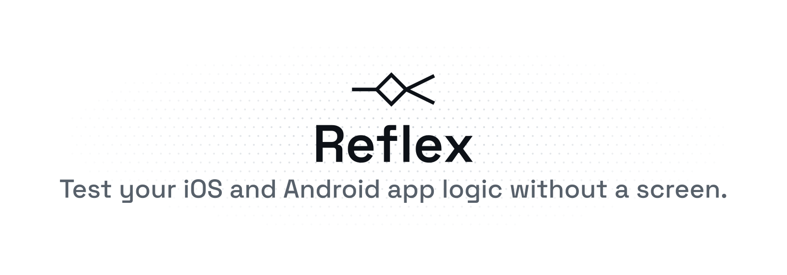
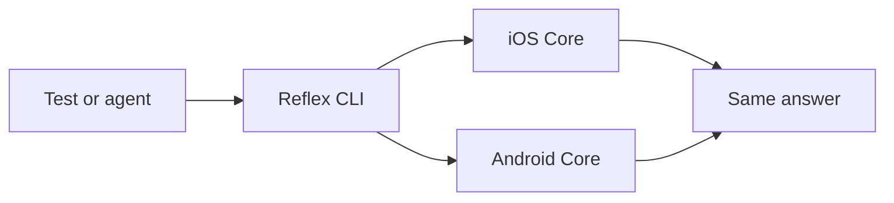

<p align="center">
  <picture>
    <source media="(prefers-color-scheme: dark)" srcset="assets/brand/readme-banner-dark.png">
    
  </picture>
</p>

Based on Shopify Engineering’s [Reflex](https://shopify.engineering/reflex) article. Reflex lets a test or an AI agent use your iOS and Android app without a screen. It asks the app what’s showing, tells it what to do and checks both apps give the same answer. This project isn’t affiliated with or endorsed by Shopify.



`ls` lists the current state and the available actions. `do` runs one action and returns the new state.

## How you use it

You want a test or an AI agent to check your app’s logic on iOS and Android without tapping through screens. The inventory sample shows the whole path.

### 1. Keep the ViewModel. Add a small adapter.

The Core ViewModel does not import ReflexKit. It still owns state and `send`:

```swift
// swift/Sources/InventoryCore/Inventory.swift
public func send(_ action: Action) { update(.viewAction(action)) }
```

```kotlin
// kotlin/core/src/main/kotlin/reflex/Inventory.kt
fun send(action: Action) = update(Message.ViewAction(action))
```

A separate adapter node reads that state and maps actions to `send`:

```swift
// swift/Sources/InventoryIntrospection/Node.swift
public struct DetailNode: Node {
    let vm: InventoryDetailViewModel
    public var name: String { "InventoryDetail" }
    public var state: JSONValue {
        // … product, saved, error from vm.state …
    }
    public var actions: [String: NodeAction] { [
        "SetQuantity": NodeAction(input: quantityInput) { args in
            // … Int conversion …
            vm.send(.setQuantity(quantity))
        },
        "Decrement": NodeAction { _ in vm.send(.decrement) },
        "Save": NodeAction { _ in vm.send(.save) }
    ] }
}
```

```kotlin
// kotlin/introspection/src/main/kotlin/reflex/Node.kt
class DetailNode(private val vm: InventoryDetailViewModel) : Node {
    override val name = "InventoryDetail"
    override val state: JsonValue get() = jsonObject(
        "product" to vm.state.product.json(), "saved" to vm.state.saved.json,
        "error" to vm.state.error?.json)
    override val actions get() = mapOf(
        "SetQuantity" to NodeAction(quantityInput) {
            vm.send(InventoryDetailViewModel.Action.SetQuantity(it.int64("quantity")))
        },
        "Decrement" to NodeAction { vm.send(InventoryDetailViewModel.Action.Decrement) },
        "Save" to NodeAction { vm.send(InventoryDetailViewModel.Action.Save) })
}
```

### 2. Add a tiny CLI entry point

```swift
// swift/Sources/InventoryCLI/main.swift
let app = InventoryApp(service: FixtureInventoryService(fixture: fixture, guardrail: network))
let session = Session(sample: "inventory", root: { AppNode(app: app) },
                      extras: { ["networkAttempts": JSONValue(network.attempts)] })
session.serveStandardIO { network.attempts > 0 ? 70 : nil }
```

```kotlin
// kotlin/cli/src/main/kotlin/reflex/Main.kt
val app = InventoryApp(FixtureInventoryService(fixture, network))
val session = Session("inventory", { AppNode(app) },
    extras = { mapOf("networkAttempts" to network.attempts.json) })
session.serveStandardIO { if (network.attempts > 0) 70 else null }
```

More adoption detail: [kit/README.md](kit/README.md).

### 3. Drive it from a terminal

After `bash scripts/build.sh`:

```bash
printf 'ls\ndo OpenProduct {"id":"shirt"}\ndo SetQuantity {"quantity":12}\ndo Save\nls\n' \
  | python3 scripts/console.py swift
```

Real replies (schema `inputs` omitted; values unchanged):

```text
$ ls
{"ok":true,"node":{"name":"InventoryList","state":{"products":[{"id":"shirt","quantity":3,"title":"Cotton shirt"},{"id":"mug","quantity":0,"title":"Ceramic mug"}]},"actions":["OpenProduct","Refresh","goBack"]},"networkAttempts":0}

$ do OpenProduct {"id":"shirt"}
{"ok":true,"node":{"name":"InventoryDetail","state":{"product":{"id":"shirt","quantity":3,"title":"Cotton shirt"},"saved":false},"actions":["Decrement","OpenProduct","Save","SetQuantity","goBack"]},"networkAttempts":0}

$ do SetQuantity {"quantity":12}
{"ok":true,"node":{"name":"InventoryDetail","state":{"product":{"id":"shirt","quantity":12,"title":"Cotton shirt"},"saved":false},"actions":["Decrement","OpenProduct","Save","SetQuantity","goBack"]},"networkAttempts":0}

$ do Save
{"ok":true,"node":{"name":"InventoryDetail","state":{"product":{"id":"shirt","quantity":12,"title":"Cotton shirt"},"saved":true},"actions":["Decrement","OpenProduct","Save","SetQuantity","goBack"]},"networkAttempts":0}
```

### 4. Turn that into a shared test

Those same steps live in `tests/inventory/journeys/01-happy.json`. Opening stretch:

```json
{
  "name": "happy",
  "fixture": "happy",
  "steps": [
    {
      "ls": true,
      "expect": {
        "ok": true,
        "node": {
          "name": "InventoryList",
          "state": {
            "products": [
              {"id": "shirt", "title": "Cotton shirt", "quantity": 3},
              {"id": "mug", "title": "Ceramic mug", "quantity": 0}
            ]
          },
          "actions": ["OpenProduct", "Refresh", "goBack"]
        }
      }
    },
    {
      "do": "OpenProduct",
      "input": {"id": "shirt"},
      "expect": {
        "ok": true,
        "node": {
          "name": "InventoryDetail",
          "state": {
            "product": {"id": "shirt", "title": "Cotton shirt", "quantity": 3},
            "saved": false
          }
        }
      }
    },
    {
      "do": "SetQuantity",
      "input": {"quantity": 12},
      "expect": {
        "ok": true,
        "node": {"state": {"product": {"quantity": 12}, "saved": false}}
      }
    },
    {
      "do": "Save",
      "expect": {
        "ok": true,
        "node": {"state": {"saved": true}}
      }
    }
  ]
}
```

Run every inventory journey on both platforms:

```bash
python3 runner/reflex_runner.py tests/inventory/reflex.json --platform both --strict
```

```text
RESULT PASS mode=strict unexpected_failures=0 xfail=0 platforms=swift,kotlin repeat=1 sample=inventory guard=canary-pass
```

### 5. What you get

The same journey runs on Swift and Kotlin with warm steps around 1.4 ms (P50 on this machine). When the two Cores disagree, the runner fails the suite. The same approach found a real rest timer crash in Workout Director: a Swift trap when adding seconds to the rest timer.

## Setup

### 1. Prerequisites

macOS, Xcode with Swift 6.0+, JDK 17+, Python 3 and Git. Optional mobile hosts: iOS simulator SDK, XcodeGen, Android SDK platform 36 and build-tools 36.0.0.

### 2. Clone

```bash
git clone https://github.com/ashishkharche/reflex.git
cd reflex
```

### 3. Build and run the Swift sample

```bash
bash scripts/build.sh
swift test --package-path kit -j 2
swift test --package-path swift -j 2
```

Expect `CONFORMANCE platform=swift cases=161 passed=161` and `Test Suite 'All tests' passed`.

### 4. Run the Kotlin sample

```bash
kotlin/gradlew -p kotlin --no-daemon --max-workers=1 :reflex-kit:test :core:test --console=plain
```

Expect `ConformanceTest` lines marked `PASSED` and `BUILD SUCCESSFUL`.

### 5. Run the shared journeys

```bash
python3 runner/reflex_runner.py tests/inventory/reflex.json --platform both --strict
```

Expect the `RESULT PASS` line above. Full notes and the outbox sample: [docs/setup.md](docs/setup.md).

## Docs

- [Setup](docs/setup.md) — full build path, outbox and layout
- [Use cases](docs/use-cases.md) — what Reflex is for
- [Architecture](docs/architecture.md) — Core, ViewModels and samples
- [CLI](docs/cli.md) — hosts and console
- [Testing](docs/testing.md) — journeys, conformance and the network guard
- [Protocol v1](docs/protocol/v1.md) — wire format
- [Adopt ReflexKit](kit/README.md) — add the kit to your app
- [Brand](docs/brand.md) — mark and colours
- [Test plan](TEST_PLAN.md) — go / no-go bar

## Licence

MIT. Copyright (c) 2026 Ashish Kharche. See [LICENSE](LICENSE).
