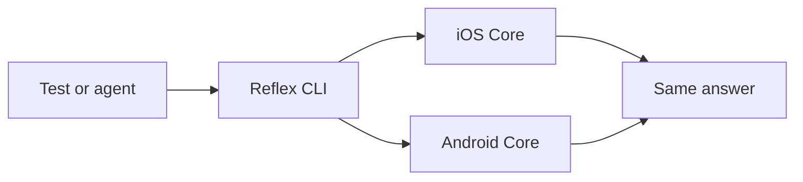

<p align="center">
  <picture>
    <source media="(prefers-color-scheme: dark)" srcset="assets/brand/readme-banner-dark.png">
    
  </picture>
</p>

Based on Shopify Engineering’s [Reflex](https://shopify.engineering/reflex) article. Reflex lets a test or an AI agent use your iOS and Android app without a screen. It asks the app what’s showing, tells it what to do and checks both apps give the same answer. This project isn’t affiliated with or endorsed by Shopify.



`ls` lists the current state and the available actions. `do` runs one action and returns the new state.

## Setup

### 1. Prerequisites

You need macOS (the network guard loads with `DYLD_INSERT_LIBRARIES`), Xcode with Swift 6.0 or newer, JDK 17 or newer, Python 3 and Git. The repo pins `swift-tools-version: 6.0` and Kotlin JVM 17. Optional mobile hosts need an iOS simulator SDK, XcodeGen, Android SDK platform 36 and build-tools 36.0.0.

### 2. Clone

```bash
git clone https://github.com/ashishkharche/reflex.git
cd reflex
```

### 3. Run the Swift sample

Build the CLIs and the macOS network guard, then run the ReflexKit and inventory Swift tests.

```bash
bash scripts/build.sh
swift test --package-path kit -j 2
swift test --package-path swift -j 2
```

You should see `CONFORMANCE platform=swift cases=161 passed=161` from the kit and `Test Suite 'All tests' passed` from the inventory package.

### 4. Run the Kotlin sample

Run the same kit and inventory tests on the JVM Core.

```bash
kotlin/gradlew -p kotlin --no-daemon --max-workers=1 :reflex-kit:test :core:test --console=plain
```

You should see each `ConformanceTest` line marked `PASSED` and `BUILD SUCCESSFUL`.

### 5. Run the shared journeys on both

Drive the inventory Core on Swift and Kotlin from one journey file.

```bash
python3 runner/reflex_runner.py tests/inventory/reflex.json --platform both --strict
```

You should see `RESULT PASS mode=strict unexpected_failures=0 xfail=0 platforms=swift,kotlin repeat=1 sample=inventory guard=canary-pass`. Full setup notes, the outbox sample and Linux guard limits: [docs/setup.md](docs/setup.md).

## Add it to your own app

Keep your Core free of the kit. Add one adapter node per ViewModel and a small CLI. Short Swift and Kotlin examples: [kit/README.md](kit/README.md).

## Docs

- [Setup](docs/setup.md) — full build path, outbox and layout
- [Use cases](docs/use-cases.md) — what Reflex is for
- [Architecture](docs/architecture.md) — Core, ViewModels and samples
- [CLI](docs/cli.md) — hosts and console
- [Testing](docs/testing.md) — journeys, conformance and the network guard
- [Protocol v1](docs/protocol/v1.md) — wire format
- [Brand](docs/brand.md) — mark and colours
- [Test plan](TEST_PLAN.md) — go / no-go bar

## Licence

MIT. Copyright (c) 2026 Ashish Kharche. See [LICENSE](LICENSE).
