# Add Reflex to your app

Step-by-step guide for adding Reflex to an existing iOS and Android app so a test or an AI agent can drive both without a screen.

<picture>
  <source media="(prefers-color-scheme: dark)" srcset="../assets/diagrams/04-assistant-setup-dark.svg">
  
</picture>

## For AI assistants

The README prompt and the [Reflex skills](assistants.md) are short on purpose. This section holds the full instructions behind them.

**Where Reflex lives**

- Its own clone next to the app repo, for example `../reflex`. A git submodule also works.
- Never copy Reflex files into the app repo.

**Keep Reflex out of the app build**

- Put the Swift Introspection target and CLI in their own package, for example `ReflexHarness/Package.swift`. Only that package points at the Reflex clone. See [2. Swift](#2-swift).
- Never add a `../reflex` dependency to the app’s own `Package.swift`, its shared Core package or its Xcode project.
- On Kotlin, include the Reflex modules only when the clone exists, as [3. Kotlin](#3-kotlin) shows. No app module depends on them.
- The app must still build after you move `../reflex` away. The optional [debug socket host](real-build.md) is the one exception. Ask before adding it.

**Scope**

- One screen per branch, for example `reflex/home`.
- Start a first setup with the main screen.
- “Every screen” or “the whole app” means: list the screens first, then do one at a time.
- After each refactor and after each screen, stop and report. Wait for a yes before the next one.

**Branch**

- Start the branch from the latest main branch.
- Before you report, run `git fetch` and count how far behind you are: `git rev-list --count HEAD..origin/main`.
- If the count is above 0, rebase onto the main branch and run every check again. Say the count in Where it is.

**First setup**

- Add one adapter that lists the main screen’s state and actions.
- Add one small CLI per platform the app has: Swift and Kotlin when both exist.
- Write a `reflex.json` manifest and one journey for that screen.

**Update**

- Pull the latest main. With a submodule, update the submodule instead.
- Read [CHANGELOG.md](../CHANGELOG.md) for changes since the app’s version.
- Apply them to the adapters, the CLIs and `reflex.json`.

**Rules**

- Keep the app’s code and behaviour unchanged. Only add new files and targets. Registering a Reflex module in `settings.gradle.kts` as [3. Kotlin](#3-kotlin) shows is part of adding it. List each such edit in the report.
- Files Reflex added earlier (adapters, CLIs, `reflex.json`, journeys) may be updated to follow this guide or the CHANGELOG. Ask before editing any other existing file.
- If a screen keeps its state in its views, ask before refactoring.
- If iOS and Android are separate repos, ask where the other one is first.
- Every adapter wraps the app’s real Core, the same object the screen uses. Never copy its rules into the adapter or the CLI to get a test to pass.
- Never hide a platform difference. Do not make one CLI copy the other platform’s value. Keep each platform’s real behaviour and mark the step with a `parity` id so the run shows `PARITY KNOWN`.

**Product changes**

- Parity often shows that the two apps behave differently. Making one match the other changes the product, not the tests.
- Never fix it on the Reflex branch. Name it under Needs your decision and ask.
- If the user says yes, make the fix on its own branch, for example `fix/home-default-tab`, in its own commit. Name that branch in the report.
- The Reflex branch keeps the `parity` mark until the fix is merged.

**Dry run**

- If the user asks for a dry run or a plan, change nothing: no clone, no writes, no installs, no builds. Reading is fine.
- Name the platforms and the main screen, say what each step would add and report INCOMPLETE with the reason “dry run”.

**Run and check**

Do all of these before you report. The runner alone is not enough.

1. Rebuild the CLIs and run the runner with `--platform both`. If the app has one platform, pass just that one. Fix any failure and rerun.
2. Build each app the way its team does, for example `xcodebuild build` and `./gradlew assembleDebug`.
3. Run each app’s existing unit tests, for example `xcodebuild test` and `./gradlew test`. Unit tests only: do not start an emulator for instrumented tests unless the user asks.
4. Check that the app’s own build files never name `../reflex`, apart from the guarded Kotlin block.

See [9. Check the app still works](#9-check-the-app-still-works).

**Report**

- Reply with the five-part report in [What you get back](#what-you-get-back).
- Use exactly these five headings in this order: Result, Needs your decision, What I added, Where it is, Try it. Never rename one, for example to “What I changed” or “Summary”.
- Result is PASS only when nothing is copied, skipped or hidden and both apps build and pass their unit tests. Otherwise it is FAIL, BLOCKED or INCOMPLETE. See [Result words](#result-words).
- Put the whole report in one fenced `text` block with a blank line between parts. Keep it under 20 lines.

Layout used below: your app and a clone of this repo sit next to each other.

```text
your-workspace/
  reflex/          # git clone https://github.com/ashishkharche/reflex.git
  your-app/        # your project
```

<picture>
  <source media="(prefers-color-scheme: dark)" srcset="../assets/diagrams/01-in-your-app-dark.svg">
  
</picture>

### If iOS and Android are separate repos

```text
your-workspace/
  reflex/           # the kit
  my-app-ios/       # its own repo, builds the Swift CLI
  my-app-android/   # its own repo, builds the Kotlin CLI
```

Put `tests/reflex.json` and `tests/journeys/` in either repo or in a small third tests repo. Each platform command in the manifest points at its own repo with a relative path, for example `"../my-app-ios/ReflexHarness/.build/debug/your-cli"` and `"-cp", "../my-app-android/cli/build/install/cli/lib/*"`. Both CLIs must use the same node names, state keys and action names.

## 0. Prerequisites

- macOS when you use the Swift (iOS) side
- A C compiler (`clang` on macOS, `cc` on Linux) for the network guard
- Xcode with Swift 6.0 or newer (Swift / iOS only)
- JDK 17 or newer
- Python 3
- Git

Linux, Docker and Linux CI work for Kotlin-only and Kotlin Multiplatform apps with `--platform kotlin`. The network guard runs there through `LD_PRELOAD` when a C compiler is installed. Windows works through WSL 2. Details: [faq.md](faq.md).

## 1. Get the kit

Clone Reflex next to your repo, not inside it. A git submodule is optional.

```bash
cd your-workspace
git clone https://github.com/ashishkharche/reflex.git
```

You will point Swift and Kotlin at `reflex/kit`.

## 2. Swift

Keep your Core free of UI and free of ReflexKit. Put the Introspection target and a small CLI in their own Swift package. Your app never resolves that package, so it builds without the Reflex clone.

```text
your-app/
  YourCore/          # the app’s Core package, unchanged
  ReflexHarness/     # new: Introspection and CLI, the only package that names ../reflex
  ios/YourApp.xcodeproj
```

```swift
// ReflexHarness/Package.swift
// swift-tools-version: 6.0
import PackageDescription

let package = Package(
    name: "ReflexHarness",
    platforms: [.macOS(.v13)],
    dependencies: [
        .package(path: "../YourCore"),
        .package(path: "../../reflex/kit")
    ],
    targets: [
        .target(name: "YourIntrospection", dependencies: [
            "YourCore", .product(name: "ReflexKit", package: "kit")
        ]),
        .executableTarget(name: "your-cli", dependencies: [
            "YourCore", "YourIntrospection", .product(name: "ReflexKit", package: "kit")
        ])
    ]
)
```

Rules for the Swift side:

| Do | Don’t |
| --- | --- |
| Point at the Reflex clone only from `ReflexHarness/Package.swift`. | Add `../reflex` to `YourCore/Package.swift` or the app’s Xcode project. |
| Depend on the Core package by path. | Copy Core files into the harness. |
| Keep `.build/` of the harness out of git. | Link ReflexKit into the phone target. |

If the Core lives only inside the Xcode project, it has to move into a local package first. That is a refactor, so ask. The optional debug [socket host](real-build.md) is the one case where the app links ReflexKit. It does so only in Debug.

## 3. Kotlin

Keep the Core as a JVM module with no Android imports. Include the kit and the Reflex modules only when the clone exists, so the app builds without it.

```kotlin
// settings.gradle.kts: add this block, leave the rest as it is
val reflexKit = file("../reflex/kit/kotlin")
if (reflexKit.isDirectory) {
    include(":introspection", ":cli", ":reflex-kit")
    project(":reflex-kit").projectDir = reflexKit
}
```

The path is relative to the folder that holds `settings.gradle.kts`. No app module depends on `:introspection`, `:cli` or `:reflex-kit`. The exception is `debugImplementation` for the optional [socket host](real-build.md).

```kotlin
// introspection/build.gradle.kts
dependencies {
    implementation(project(":core"))
    api(project(":reflex-kit"))
}
```

```kotlin
// cli/build.gradle.kts
plugins { kotlin("jvm"); application }
dependencies {
    implementation(project(":core"))
    implementation(project(":introspection"))
}
application { mainClass.set("yourapp.MainKt") }
```

Use JVM 17. Build the CLI with one worker and no daemon on a small machine:

```bash
./gradlew --no-daemon --max-workers=1 :cli:installDist
```

## 4. One adapter node per ViewModel

An adapter is a small type that implements ReflexKit’s `Node`. It exposes a name, JSON state and named actions. It only calls `send` on your ViewModel.

Tiny counter example (JSON integers only):

```swift
// Core: no ReflexKit import
public final class CounterViewModel {
    public struct State { public var count: Int }
    public enum Action { case increment, set(Int) }
    public private(set) var state = State(count: 0)
    public func send(_ action: Action) { /* update state */ }
}
```

```swift
// Introspection
import ReflexKit
private let setInput = Schema([.required("value", .int64)])
public struct CounterNode: Node {
    let vm: CounterViewModel
    public var name: String { "Counter" }
    public var state: JSONValue { ["count": JSONValue(vm.state.count)] }
    public var actions: [String: NodeAction] { [
        "Increment": NodeAction { _ in vm.send(.increment) },
        "Set": NodeAction(input: setInput) { args in
            vm.send(.set(Int(args.int64("value"))))
        }
    ] }
}
```

```kotlin
// Core: no ReflexKit import
class CounterViewModel {
    data class State(val count: Int)
    sealed interface Action {
        data object Increment : Action
        data class Set(val value: Long) : Action
    }
    var state = State(0); private set
    fun send(action: Action) { /* update state */ }
}
```

```kotlin
// Introspection
import reflex.kit.*
private val setInput = Schema(Field.required("value", FieldType.int64))
class CounterNode(private val vm: CounterViewModel) : Node {
    override val name = "Counter"
    override val state: JsonValue get() = jsonObject("count" to vm.state.count.json)
    override val actions get() = mapOf(
        "Increment" to NodeAction { vm.send(CounterViewModel.Action.Increment) },
        "Set" to NodeAction(setInput) {
            vm.send(CounterViewModel.Action.Set(it.int64("value")))
        }
    )
}
```

## 5. A small CLI per platform

The CLI builds your root node and serves protocol v1 on stdin/stdout.

```swift
import ReflexKit
let vm = CounterViewModel()
Session(sample: "counter", root: { CounterNode(vm: vm) }).serveStandardIO()
```

```kotlin
import reflex.kit.Session
fun main() {
    val vm = CounterViewModel()
    Session("counter", { CounterNode(vm) }).serveStandardIO()
}
```

Build Swift with two jobs:

```bash
swift build --package-path ReflexHarness -j 2
```

## 6. Try it by hand

The CLI speaks NDJSON (one JSON object per line). Send `hello`, then `ls` and `do`:

```bash
printf '%s\n' \
  '{"op":"hello","protocol":1}' \
  '{"op":"ls"}' \
  '{"op":"do","action":"Increment"}' \
  | ReflexHarness/.build/debug/your-cli
```

You should see `"ok":true` and `"state":{"count":1}` after Increment.

## 7. Manifest and journey

Create `tests/reflex.json`. `root` is your app directory (relative to the manifest). Point conformance and the network guard at the reflex clone. Do not set `warm` until a journey restores starting state; warm timings reuse one process.

```json
{
  "sample": "counter",
  "protocol": 1,
  "root": "..",
  "conformance": "../reflex/kit/conformance/strict-decoder.json",
  "guard": {
    "source": "../reflex/scripts/network_guard.c",
    "library": ".build/network_guard.dylib"
  },
  "platforms": {
    "swift": {
      "command": ["{root}/ReflexHarness/.build/debug/your-cli"]
    },
    "kotlin": {
      "command": [
        "{java}",
        "-Xmx96m",
        "-cp",
        "{root}/kotlin/cli/build/install/cli/lib/*",
        "yourapp.MainKt"
      ]
    }
  },
  "journeys": ["tests/journeys/*.json"]
}
```

One journey file:

```json
{
  "name": "count",
  "steps": [
    {
      "ls": true,
      "expect": {
        "ok": true,
        "node": {
          "name": "Counter",
          "state": {"count": 0},
          "actions": ["Increment", "Set"]
        }
      }
    },
    {
      "do": "Increment",
      "expect": {
        "ok": true,
        "node": {"state": {"count": 1}}
      }
    },
    {
      "do": "Set",
      "input": {"value": 5},
      "expect": {
        "ok": true,
        "node": {"state": {"count": 5}}
      }
    }
  ]
}
```

Full field list: [runner/README.md](../runner/README.md).

## 8. Run the shared journeys

`bash scripts/build.sh` is only for this repo’s samples. For your app, build the two CLIs as above, then:

```bash
python3 ../reflex/runner/reflex_runner.py tests/reflex.json --platform both
```

PASS looks like:

```text
RESULT PASS mode=xfail-tracked unexpected_failures=0 xfail=0 platforms=swift,kotlin repeat=1 sample=counter guard=canary-pass
```

FAIL names the step and the first mismatching path:

```text
FAIL platform=swift journey=… step=1 action=ls send={"op":"ls"} $.node.state.count expected=99 (integer) actual=0 (integer) …
RESULT FAIL mode=xfail-tracked unexpected_failures=1 xfail=0 platforms=swift repeat=1 sample=counter guard=canary-pass
```

## 9. Check the app still works

A green runner proves the adapters agree. It does not prove the app still builds. Run these too before you call it done.

| Check | iOS example | Android example |
| --- | --- | --- |
| The app builds | `xcodebuild -scheme YourApp -destination 'generic/platform=iOS Simulator' build` | `./gradlew --no-daemon :app:assembleDebug` |
| Its unit tests pass | `xcodebuild test -scheme YourApp -destination 'platform=iOS Simulator,name=iPhone 16'` | `./gradlew --no-daemon test` |
| No Reflex in its build files | `git grep -n "\.\./reflex" -- '*.swift' '*.pbxproj'` lists only `ReflexHarness/` | `git grep -n "\.\./reflex" -- '*.kts'` lists only the guarded block |

Use the app’s own scheme, tasks and simulator names. Unit tests run on the JVM or a simulator. Instrumented tests on an emulator are not needed.

If the app fails to build or a unit test fails, the result is FAIL, even when the runner passed. If a check can’t run on this machine, the result is INCOMPLETE and the reason goes under Needs your decision.

## What you get back

If you used the AI prompt or the skills, the assistant ends with a five-part report. It follows these rules so it stays readable in a terminal:

- The whole report sits in one fenced `text` block so the line breaks survive.
- It has exactly five headings in this order, spelled as below, each on its own line. A blank line separates the parts. Add no other heading and never rename one, for example to “What I changed”.

| Heading | What goes under it |
| --- | --- |
| Result | One result word plus the platforms, for example “PASS on swift and kotlin”. A second line says whether both apps built and passed their unit tests. |
| Needs your decision | A numbered list with one decision per item, at most two short lines each. “None” if empty. Every reason for FAIL, BLOCKED or INCOMPLETE appears here. So does every product change. |
| What I added | One bullet per file or folder, including files updated on an update and each edit to an existing build file. |
| Where it is | Branch, commit, pushed or not and how many commits it is behind the main branch, one line each. |
| Try it | The runner command alone on its own line. |

Keep it under 20 lines in total, with no long sentences.

### Result words

Use the first word that applies.

| Word | When |
| --- | --- |
| FAIL | The runner printed `RESULT FAIL` or stopped with an error. An app failed to build or one of its unit tests failed. |
| BLOCKED | You can’t finish without the user. For example a screen needs a refactor before an adapter can wrap its real Core. |
| INCOMPLETE | The runner passed but something is not covered. See the list below. |
| PASS | The runner printed `RESULT PASS`, both apps build and pass their unit tests, every adapter wraps the real Core the screen uses and no platform difference is marked or hidden. |

INCOMPLETE covers these cases:

- An adapter wraps a copy of the rules.
- A screen’s view still does the real work. The model only mirrors it or the tests drive a copy of its logic. Name the screen under Needs your decision.
- A platform the app has was not run.
- A step is marked `parity` or `xfail`.
- The runner printed `PASS-UNGUARDED`.
- An app build or its unit tests could not be run.
- A CLI starts from an empty or made-up state while the app fills that state in somewhere else, such as a planner or a view.

A `parity` or `xfail` mark covers one known difference between the platforms. It must not hide state the CLI is missing.

When the Result is FAIL or BLOCKED, still name every screen that would be INCOMPLETE, with its reason, under Needs your decision.

A green runner line is not enough for PASS. A test that passes because an adapter copies the rules or because both CLIs use one platform’s value proves nothing about the app.

Example:

```text
Result
INCOMPLETE on swift and kotlin
Both apps build. Unit tests pass on both.

Needs your decision
1. Home opens on Inbox on iOS and Today on Android.
   Marked known here. Say yes and I fix it on its own branch.
2. Search keeps its state in the views, so it has no test yet.
   Say yes to move Search onto a shared Core.

What I added
- tests/reflex.json and tests/journeys/home.json
- HomeNode and home-cli (Swift and Kotlin)

Where it is
Branch: reflex/home
Commit: abc1234, not pushed
Behind main: 0 commits

Try it
python3 ../reflex/runner/reflex_runner.py tests/reflex.json --platform both
```

## 10. Troubleshooting

| Symptom | What to check |
| --- | --- |
| `host binary not found` | Build the Swift executable and run Gradle `:cli:installDist` first. |
| `json.malformed` on the first line | Send `{"op":"hello","protocol":1}` before `ls` or `do`. Human `ls` / `do` lines are not the wire format; use JSON objects. |
| Kotlin and Swift disagree on keys | Both kits compare keys by exact UTF-16 code units. Use the same spellings. |
| Warm timing fails after a green suite | The warm run reuses one process. Omit `warm` until the journey resets state. Another option is a reset action. |
| `RESULT PASS-UNGUARDED`, exit 3 | The guard did not run, so network isolation is not proved. Install a C compiler on Linux. Pass `--allow-unguarded` only when you accept that. |
| SIP drops the guard on `/usr/bin/java` | Prefer `{java}` from `JAVA_HOME` in the manifest. The runner resolves a real binary. |

More protocol detail: [protocol/v1.md](protocol/v1.md). Kit API table: [kit/README.md](../kit/README.md).

## Updating Reflex

Paste the same README AI prompt again; it pulls the latest clone (or updates the submodule), reads [CHANGELOG.md](../CHANGELOG.md) and reruns the suite. By hand:

1. Pull the latest kit: `git -C ../reflex pull`. If you use a submodule, run `git submodule update --remote reflex` instead.
2. Read [CHANGELOG.md](../CHANGELOG.md) for protocol or kit API changes since your version and apply them to your adapters, CLIs and `reflex.json`.
3. Rebuild both CLIs: the Swift executable and Gradle `:cli:installDist`.
4. Rerun the runner: `python3 ../reflex/runner/reflex_runner.py tests/reflex.json --platform both`.
5. Build both apps and run their unit tests as in [9. Check the app still works](#9-check-the-app-still-works).

Environments, other stacks and CI notes: [faq.md](faq.md).
