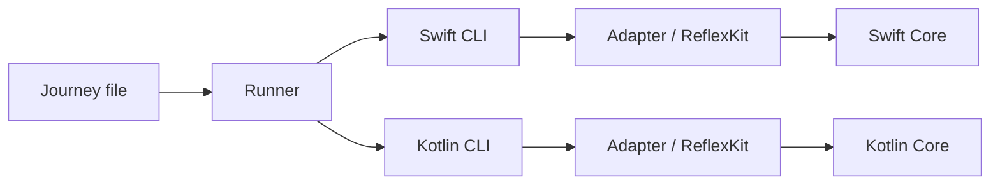

# How it works

Architecture overview for people who want to see how a Core, adapter, CLI and runner fit together. Reference: https://shopify.engineering/reflex

## Intro

Reflex keeps business logic in a UI-free [Core](glossary.md). A thin [adapter node](glossary.md) describes each screen. A [CLI](glossary.md) speaks [protocol v1](protocol/v1.md). The [runner](glossary.md) drives the same [journey](glossary.md) on Swift and Kotlin and fails when the answers differ.

## The pieces

| Piece | What it is | Where it lives |
| --- | --- | --- |
| Core | Business logic, no UI, no ReflexKit | `swift/Sources/InventoryCore`, `kotlin/core`, `samples/outbox/*/core` |
| ViewModel | Typed state + `send` / `update` for one screen | Inside each Core |
| Adapter node | Name, JSON state, actions → `send` | `swift/Sources/InventoryIntrospection`, `kotlin/introspection`, outbox introspection modules |
| ReflexKit | Strict decoder, `Node`, `Session` | `kit/` (Swift package and `kit/kotlin`) |
| CLI | NDJSON host for one sample | `swift/Sources/InventoryCLI`, `kotlin/cli`, outbox CLIs |
| Journey | Shared `ls` / `do` steps | `tests/inventory/journeys/`, `samples/outbox/journeys/` |
| Runner | Parity + guard + `RESULT` | `runner/reflex_runner.py` |
| Network guard | Denies Internet sockets in tests | `scripts/network_guard.c` |

## What happens on `ls` and `do`

1. The runner (or you) sends `{"op":"hello","protocol":1}` once per process.
2. `ls` asks the focused [adapter node](glossary.md) for its name, state and actions.
3. `do` names an action and optional JSON input. ReflexKit decodes the input with the action’s schema.
4. The adapter calls `send` on the ViewModel. The Core updates state.
5. The reply includes `ok` and the new `node` snapshot. Both platforms must match on a shared journey.

## Rules the Core follows

- No UI framework imports in the Core.
- No ReflexKit imports in the Core.
- One `update` path writes state after construction.
- Services and clocks arrive through constructors (fixtures in tests).
- Navigation is Core state when the sample has more than one screen.
- Adapters only serialize state and dispatch actions; they do not invent business rules.

## Network guard

On macOS the runner loads `scripts/network_guard.c` through `DYLD_INSERT_LIBRARIES` before a behavior session. It denies Internet `connect`, `connectx` and `sendto` and records attempts. The runner fails a session that skips the ready marker or that attempts a request.

This is a deterministic test aid. It is not a security boundary against malicious native code. It is macOS only. Off macOS the runner prints `guard=skipped-not-macos` and network isolation is not exercised. Mobile release builds do not include it.

## The samples

### Inventory

A list and detail flow with quantity edits. Code lives under `swift/`, `kotlin/` and `tests/inventory/`. Sample rules: [samples/inventory/README.md](../samples/inventory/README.md).

### Outbox

An offline queue with backoff and idempotency keys. Code lives under `samples/outbox/`. Sample rules: [samples/outbox/README.md](../samples/outbox/README.md).

No Shopify library is imported. Shared artifacts are journey files and the conformance fixture, not application code.
